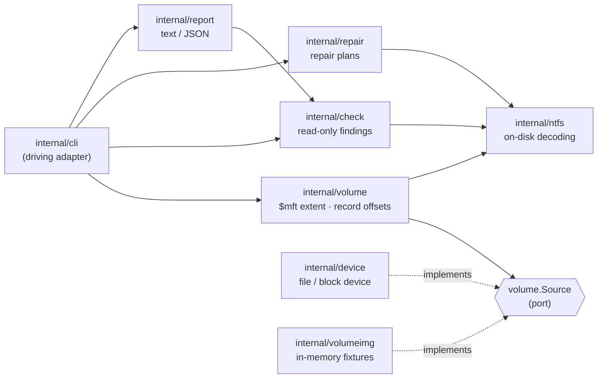

# ntfsck

[](https://go.dev/) [](./LICENSE) [](#status)

`ntfsck` is a read-only-first NTFS consistency checker and repairer for Linux.
It inspects a volume, reports what diverges, and — when asked to repair — first
prints the exact plan it would apply, so nothing is written before you have seen
it.

It exists because a real-world volume came back with `$MFTMirr != $MFT`, and
`ntfsfix` only repaired it partially. `ntfsck` reproduces that diagnosis from the
on-disk structures themselves, without a kernel driver or a mount.

## Demo

```console
$ ntfsck --check /dev/sdb1
NTFS volume:  NTFS
Cluster size: 4096 bytes
MFT records: 28

[OK]    $mftmirr  record 0 matches $mft
[OK]    $mftmirr  record 1 matches $mft
[OK]    $mftmirr  record 2 matches $mft
[WARN]  $mftmirr  record 3 ($volume) differs from $mft
[WARN]  $mftmirr  1 of 4 mirrored records diverge from $mft

Not checked yet: $bitmap, $logfile, $secure

Filesystem is inconsistent. Repair recommended.
$ echo $?
3
```

Ask for the repair plan and `ntfsck` tells you what it would do, without doing it:

```console
$ ntfsck --repair --dry-run /dev/sdb1
$mftmirr: rewrite the mirrored copy at cluster 8191 from $mft

1 action(s) planned; writing is not enabled yet.
```

## Getting Started

### From source

```bash
git clone https://github.com/fabianoflorentino/ntfsck.git
cd ntfsck
make build          # writes bin/ntfsck
```

### With the Go toolchain

```bash
go install github.com/fabianoflorentino/ntfsck/cmd/ntfsck@latest
```

### Requirements

- Linux (the checker reads raw devices and files)
- Go 1.27 or later to build from source

## Usage

```
ntfsck [flags] <device>
```

`<device>` is a block device (`/dev/sdb1`) or a filesystem image file.

| Flag | Description |
| --- | --- |
| `--check` | Analyze the volume without writing anything. |
| `--repair` | Plan the repairs the volume needs. |
| `--dry-run` | With `--repair`, plan only and never open the volume for writing. |
| `--dump-mft` | Print one MFT record header for manual inspection. |
| `--mft-record <n>` | MFT record index to print with `--dump-mft` (default `0`). |
| `--output text\|json` | Report format (default `text`). |
| `-v, --version` | Print the version and exit. |

`--check`, `--repair`, and `--dump-mft` are mutually exclusive, as are `--dry-run`
and `--check`/`--dump-mft`. A scan that also writes is exactly the ambiguity this
tool exists to remove.

### Examples

```bash
ntfsck --check /dev/sdb1                     # read-only diagnosis
ntfsck --check --output json /dev/sdb1       # machine-readable report
ntfsck --dump-mft --mft-record 0 /dev/sdb1   # inspect a raw record header
ntfsck --repair --dry-run /dev/sdb1          # show the plan, write nothing
```

### Exit codes

| Code | Meaning |
| --- | --- |
| `0` | The volume is consistent, or the request succeeded. |
| `1` | `ntfsck` could not complete the request. |
| `2` | The command line was wrong. |
| `3` | The check completed and found problems. |

The distinction between `1` and `3` lets a script tell "the volume is broken"
from "the tool could not run".

## Features

### Consistency checks

| Structure | Status | What is verified |
| --- | --- | --- |
| `$mftmirr` | Implemented | The leading mirrored records match their `$mft` originals. |
| `$bitmap` | Not yet | Cluster allocation bitmap against the MFT. |
| `$logfile` | Not yet | Journal replay state and consistency. |
| `$secure` | Not yet | Security descriptor integrity. |

Structures that are not examined yet are reported in a separate `Not checked
yet` line and in the `not_covered` JSON field. They can never be mistaken for a
pass, and they never mark a healthy volume as inconsistent.

### Read-only first

`--check` opens the source read-only. The device adapter enforces that: every
write on a read-only handle fails with `ErrReadOnly` before touching the medium.
Repair produces a plan; the current build does not apply it.

### Output formats

- **`text`** — an operator-facing summary built for a terminal.
- **`json`** — a stable document for scripts and dashboards.

```json
{
  "volume": "NTFS    ",
  "cluster_size": 4096,
  "record_count": 28,
  "consistent": false,
  "findings": [
    { "structure": "$mftmirr", "severity": "WARN", "detail": "record 3 ($volume) differs from $mft" }
  ],
  "not_covered": ["$bitmap", "$logfile", "$secure"]
}
```

## Architecture

`ntfsck` is hexagonal: a pure decoding library and a small read/repair core,
with the device and the test fixture plugged in as adapters.



See [docs/architecture.md](docs/architecture.md) for the full component map,
[docs/how-it-works.md](docs/how-it-works.md) for the end-to-end flow, and the
[documentation index](docs/README.md) for everything else.

## Project layout

```
cmd/ntfsck          main and the testable Run entry point
internal/cli        Cobra command tree and exit codes
internal/ntfs       boot sector, MFT record, attribute and runlist decoding
internal/volume     opens a source and resolves the $mft extent
internal/check      consistency findings
internal/repair     repair plans (no writes yet)
internal/report     text and JSON rendering
internal/device     real file / block-device adapter
internal/volumeimg  in-memory fixture adapter for tests
```

## Status

The build is intentionally read-only-first: it diagnoses and plans, but does not
yet apply repairs. Coverage grows one structure at a time, and every new check
lands with its fixture and tests before its repair is enabled.

## Contributing

Please read the [contributing guide](CONTRIBUTING.md) before opening a pull
request.

## License

This project is licensed under the MIT License — see the [LICENSE](LICENSE) file
for details.
