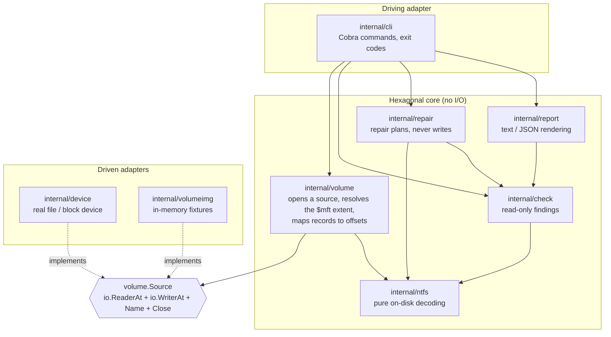
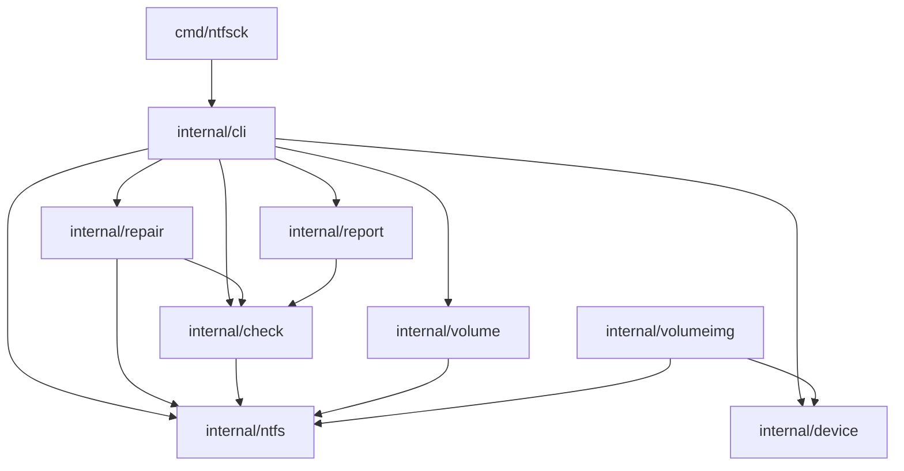

# Architecture

`ntfsck` is organised as a **hexagonal** (ports and adapters) application. The
rules are few and enforced by the compiler:

1. The core depends on nothing that does I/O. `internal/ntfs` is pure decoding:
   it takes bytes and returns values, so every structure is testable against a
   slice.
2. The core talks to the outside through **ports** — small interfaces declared
   where they are *consumed*, not next to their implementations.
3. **Adapters** implement those ports. The real device and the in-memory test
   fixture are interchangeable from the core's point of view.
4. There is no DI framework. The whole object graph is wired by hand in
   `internal/cli.openVolume`, which is the single seam between the domain and a
   concrete medium.

## Component map

## Packages

| Package | Responsibility | Performs I/O |
| --- | --- | --- |
| `internal/ntfs` | Boot sector, MFT record header, attribute header, runlist decoding. Pure functions over `[]byte`. | No |
| `internal/volume` | Opens a `Source`, resolves the `$mft` extent from record 0, turns a record index into a byte offset. | Via `Source` |
| `internal/check` | Inspects structures and produces `Finding`s. | Via port |
| `internal/repair` | Turns findings into an ordered `Plan`. | Via port |
| `internal/report` | Renders a `check.Report` as text or JSON. | Writes to an `io.Writer` |
| `internal/device` | Adapter over a file or block device; enforces read-only. | Yes |
| `internal/volumeimg` | Adapter over an in-memory image; builds fixtures. | In memory |
| `internal/cli` | Command tree, flag parsing, exit codes, wiring. | Yes |
| `cmd/ntfsck` | `main` and the testable `Run` entry point. | Process streams |

## Ports and adapters

A port belongs to the package that *consumes* it. That is the whole reason the
interfaces are scattered rather than collected in one `ports` package: each
consumer names only the methods it actually calls (interface segregation).

| Port | Declared in | Consumed by | Implemented by |
| --- | --- | --- | --- |
| `volume.Source` | `internal/volume/port.go` | `volume.Open` | `device.File`, `device.Section`, `volumeimg.Bytes` |
| `check.Volume` | `internal/check/check.go` | `check.Checker` | `*volume.Volume` |
| `repair.Volume` | `internal/repair/repair.go` | `repair.Repairer` | `*volume.Volume` |

The ports are deliberately narrow. `repair.Volume` exposes only read access
(`MFTRecordBytes`); the ability to *write* is a separate, narrower concern that a
future apply step will request explicitly. This is what makes "read-only first"
a property of the type system rather than a promise in the docs.

## Dependency graph

Arrows point from importer to imported package; the graph is acyclic.

No package under `internal/` imports `internal/cli` or `cmd`, and the decoders in
`internal/ntfs` import nothing but the standard library.

## Context and cancellation

`Run` methods take a `context.Context` and check it between records, so a scan
over a large volume stops at the next checkpoint on `SIGINT` or `SIGTERM`. The
signal-to-context bridge lives in `internal/cli.signalContext`. Because a repair
is planned before anything is written, an interrupted `--repair` can never leave
a half-written structure.

## Extension points

- **New adapter** — implement `volume.Source` and pass it to `volume.Open`. The
  core does not change.
- **New check** — add a method to `check.Checker` returning `[]Finding`, and
  list the structure in `Report.NotCovered` until it is implemented. See
  [how-to/add-a-check.md](how-to/add-a-check.md).
- **New report format** — add a `report.Format` and a `writeX` function; flag
  validation and help text pick it up from `report.Formats()`.

## Decisions

The reasoning behind the shape is recorded as ADRs:

- [ADR 0001 — Hexagonal architecture](adr/0001-hexagonal-architecture.md)
- [ADR 0002 — Read-only first](adr/0002-read-only-first.md)

See also [How it works](how-it-works.md) for the runtime flow.
