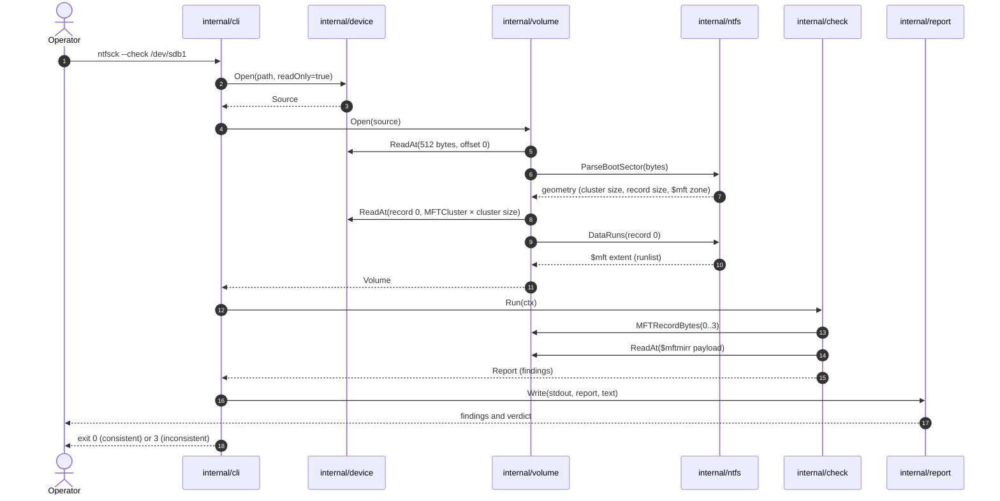
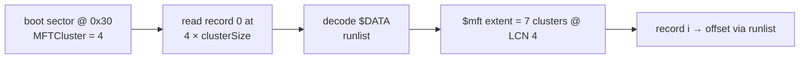
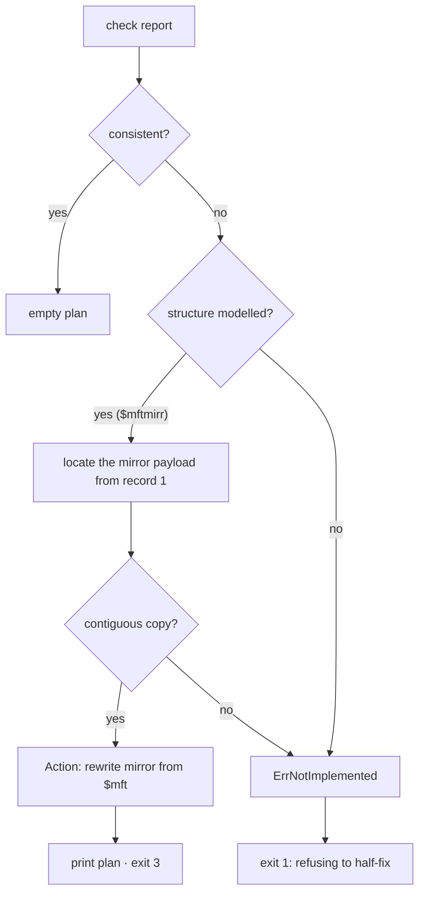

# How it works

This page follows one `ntfsck` run end to end: how the volume is opened, how the
`$mft` is located, how a check reaches a verdict, and how a repair becomes a plan.

## One run, step by step



## 1. The volume is opened read-only

`internal/cli.openVolume` is the only place that knows about a concrete medium.
It asks `device.Open(path, readOnly=true)` for a `Source`, then hands it to
`volume.Open`. On a read-only handle the adapter fails every write with
`ErrReadOnly` before touching the medium, so a `--check` cannot mutate a volume
even by accident. `--repair` without `--dry-run` opens read-write; `--repair
--dry-run` still opens read-only.

## 2. The boot sector gives the geometry

`volume.Open` reads the first 512 bytes and calls `ntfs.ParseBootSector`. The boot
sector yields the cluster size, the MFT record size (decoded from the signed
clusters-per-record field at `0x40`), and the **`$mft` zone cluster** at `0x30`.
Parsing fails with `ntfs.ErrNotNTFS` when the signature is not `NTFS    `.

## 3. The `$mft` extent comes from record 0, not the boot sector

This is the part that surprises people. The boot sector gives the cluster where
the `$mft` *starts* — but not its runlist. The authoritative description of the
`$mft` extent lives in **record 0 of the `$mft` itself**, inside its unnamed
`$DATA` attribute. On a volume whose `$mft` is fragmented, following the boot
sector alone would read the wrong records.

So `volume.Open`:



On a freshly created 64 MiB volume, record 0's `$DATA` runlist is:

```
11 07 04
```

- `0x11` — header: one length byte, one offset byte
- `0x07` — length: 7 clusters
- `0x04` — offset: start at cluster 4

`ntfs.ParseRunList` decodes this into `[]Run{{FirstCluster: 4, Length: 7}}`, and
`ntfs.ClusterAt` later resolves a runlist-relative cluster index to a volume
cluster. See [On-disk formats](reference/on-disk-formats.md) for the full
encoding.

## 4. The `$mftmirr` check

NTFS keeps a copy of the first four `$mft` records in `$mftmirr`. The checker:

1. Reads records 0–3 from the `$mft` extent (authoritative).
2. Decodes record 1 (`$mftmirr`) to find the cluster holding the mirrored copy.
3. Reads the same number of records from that payload.
4. Compares each pair **byte for byte**.

Each pair yields a `Finding` (`OK` or `WARN`), followed by one aggregate finding
such as `1 of 4 mirrored records diverge from $mft`.

A structure that cannot be read is reported as a `WARN` finding, never silently
as a pass. Structures the build does not model at all (`$bitmap`, `$logfile`,
`$secure`) are listed in `Report.NotCovered` — a separate field, so they never
affect the verdict.

## 5. From findings to a repair plan

`--repair` runs the same check, then asks `repair.Repairer` to turn the report
into an ordered `Plan`. The plan is deduplicated per structure: the checker emits
a finding per record, but a repair is one write covering the whole extent.



`--repair` prints the plan. The current build does **not** apply it: writing is
withheld until every fix is modelled and tested. That is why an unimplemented
structure returns `ErrNotImplemented` rather than a partial plan — a partial plan
looks complete, and this tool exists to remove exactly that ambiguity.

## 6. The verdict becomes an exit code

- No finding reached `WARN` → `Report.Consistent()` is true → exit `0`.
- A `WARN` or `ERROR` finding exists → exit `3`.
- A failure before a verdict (unreadable boot sector, I/O error) → exit `1`.
- A bad command line → exit `2`.

See the [CLI reference](reference/cli.md) for the full table.
